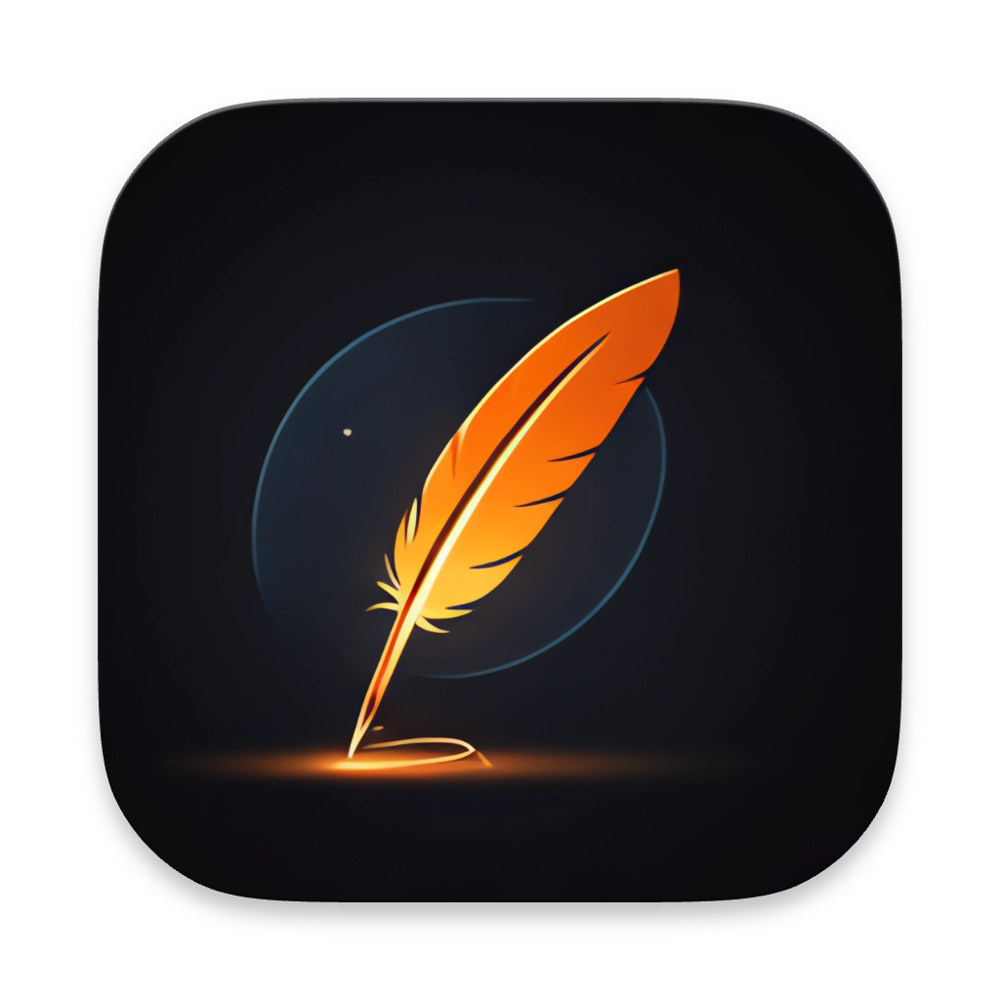

# Better Agent Terminal (更好用的代理終端機)

<div align="center">




**支援多工作區與 Claude Code 整合的跨平台終端機管理器**

[下載最新版本](https://github.com/tony1223/better-agent-terminal/releases/latest)

[English Version](./README.md)

</div>

---

## 螢幕截圖

<div align="center">

</div>

---

## 功能特色

### 工作區管理 (Workspace Management)
- **多工作區** — 依據專案資料夾整理終端機
- **拖放功能** — 自由重新排序工作區
- **群組分類** — 透過下拉選單過濾與分類工作區
- **可拆分視窗** — 將工作區彈出至獨立視窗，重啟後自動重新附加
- **各別工作區環境變數** — 針對不同工作區配置獨立的環境變數
- **活動指示器** — 查看哪些工作區有正在運行的終端機
- **雙擊重新命名**，右鍵選單提供所有操作

### 終端機 (Terminal)
- **Google Meet 風格佈局** — 70% 主面板 + 30% 縮圖欄
- **每個工作區支援多個終端機** — 使用 xterm.js，完整支援 Unicode/CJK (中日韓) 字元
- **標籤頁導覽** — 提供 終端機 (Terminal) / 檔案 (Files) / Git 檢視模式
- **檔案瀏覽器** — 搜尋、瀏覽並預覽支援語法高亮顯示的檔案
- **Git 整合** — 差異檢視器 (Diff viewer)、分支顯示、未追蹤檔案、GitHub 連結偵測
- **程式碼片段管理器** — 儲存、整理並貼上常用的程式碼片段

### Claude Code 代理人 (Claude Code Agent)
- **內建 Claude Code** 透過 SDK 整合 — 無需另外開啟終端機
- **訊息串流** 支援延伸思考 (可摺疊)
- **基於權限的工具執行** 支援略過模式
- **活動任務欄** — 查看正在運行的操作及其耗時
- **會話恢復** — 跨重啟持久化並恢復對話
- **休息/喚醒會話** — 從右鍵選單暫停或恢復代理人會話
- **狀態欄** — 顯示 Token 使用量、費用、上下文窗口百分比、模型、Git 分支、執行時間
- **提示詞歷史紀錄** — 從狀態欄查看並複製所有使用者提示詞
- **圖片附件** — 支援拖放或按鈕上傳 (最多 5 張圖片)
- **可點擊的 URL** — Markdown 連結與純網址皆可透過預設瀏覽器開啟
- **可點擊的檔案路徑** — 預覽支援語法高亮顯示的檔案，支援搜尋 (Ctrl+F)
- **Ctrl+P 檔案選取器** — 搜尋並將檔案附加到上下文 (Context)

---

## 鍵盤快捷鍵

| 快捷鍵 | 動作 |
|---|---|
| `Ctrl+P` / `Cmd+P` | 檔案選取器 (搜尋並附加檔案) |
| `Shift+Tab` | 在終端機與代理人模式之間切換 |
| `Enter` | 發送訊息 |
| `Shift+Enter` | 插入換行 (多行輸入) |
| `Escape` | 停止串流 / 關閉彈出視窗 |
| `Ctrl+Shift+C` | 複製選取文字 |
| `Ctrl+Shift+V` | 從剪貼簿貼上 |
| `滑鼠右鍵` | 複製 (如有選取) 或貼上 |

## 斜線指令 (Slash Commands)

| 指令 | 說明 |
|---|---|
| `/resume` | 恢復之前的 Claude 會話 |
| `/model` | 在可用模型之間切換 |

---

## 快速開始

### 選項 1：下載發行版本

從 [Releases](https://github.com/tony1223/better-agent-terminal/releases/latest) 下載適合您平台的版本：

| 平台 | 格式 |
|---|---|
| Windows | NSIS 安裝程式, `.zip` |
| macOS | `.dmg` (通用二進位檔) |
| Linux | `.AppImage` |

**macOS DMG 安裝說明：**

1. 從 Releases 下載 `.dmg` 檔案
2. 雙擊 `.dmg` 進行掛載
3. 將 **Better Agent Terminal** 拖曳到 **Applications** (應用程式) 資料夾
4. 第一次啟動時，macOS 可能會阻擋該應用程式 — 請前往 **系統設定 > 隱私權與安全性**，向下捲動並點擊 **仍要開啟**
5. 確保已安裝 [Claude Code CLI](https://docs.anthropic.com/en/docs/claude-code) (`npm install -g @anthropic-ai/claude-code`)

### 選項 2：從原始碼建置

**先決條件：**
- [Node.js](https://nodejs.org/) 18+
- 已安裝並通過身分驗證的 [Claude Code CLI](https://docs.anthropic.com/en/docs/claude-code)

```bash
git clone https://github.com/tony1223/better-agent-terminal.git
cd better-agent-terminal
npm install
```

**開發模式：**
```bash
npm run dev
```

**正式環境建置：**
```bash
npm run build
```

### macOS 建置注意事項

原生相依項目 (`node-pty`, `better-sqlite3`) 需要 Xcode 命令列工具：

```bash
xcode-select --install
```

接著：

```bash
npm install
npm run dev      # 開發
npm run build    # 建置 .dmg
```

---

## 架構

```
better-agent-terminal/
├── electron/
│   ├── main.ts                 # Electron 主程序, 視窗管理
│   ├── preload.ts              # IPC 橋接
│   ├── pty-manager.ts          # PTY 程序管理 (多視窗廣播)
│   └── claude-agent-manager.ts # Claude SDK 會話管理
├── src/
│   ├── components/
│   │   ├── Sidebar.tsx         # 工作區列表, 群組, 右鍵選單
│   │   ├── WorkspaceView.tsx   # 主要工作區容器
│   │   ├── ClaudeAgentPanel.tsx# Claude Code 代理人 UI
│   │   ├── TerminalPanel.tsx   # xterm.js 終端機
│   │   ├── ThumbnailBar.tsx    # 終端機縮圖列表
│   │   ├── PathLinker.tsx      # 可點擊路徑與網址, 檔案預覽彈窗
│   │   └── SnippetSidebar.tsx  # 片段管理員
│   ├── stores/
│   │   ├── workspace-store.ts  # 工作區狀態管理
│   │   └── settings-store.ts   # 應用程式設定
│   ├── types/
│   │   ├── index.ts            # 核心型別
│   │   └── claude-agent.ts     # Claude 訊息型別
│   └── styles/
│       ├── main.css
│       ├── claude-agent.css
│       └── path-linker.css
└── package.json
```

### 技術棧 (Tech Stack)
- **前端:** React 18 + TypeScript
- **終端機:** xterm.js + node-pty
- **框架:** Electron 28
- **AI:** @anthropic-ai/claude-agent-sdk
- **建置:** Vite + electron-builder
- **儲存:** better-sqlite3

---

## 配置 (Configuration)

工作區與設定儲存路徑：

| 平台 | 路徑 |
|---|---|
| Windows | `%APPDATA%/better-agent-terminal/` |
| macOS | `~/Library/Application Support/better-agent-terminal/` |
| Linux | `~/.config/better-agent-terminal/` |

---

## 發行 (Release)

### 版本格式

版本遵循： `1.YY.MMDDHHmmss`

範例： `v1.25.1219091538` = 2025-12-19 09:15:38

### 自動化發行 (GitHub Actions)

推播一個標籤 (tag) 以觸發所有平台的建置：

```bash
git tag v1.37.0
git push origin v1.37.0
```

---

## 授權 (License)

MIT 授權 - 詳情請參閱 [LICENSE](LICENSE)。

---

## 作者

**TonyQ** - [@tony1223](https://github.com/tony1223)

## 貢獻者

- **lmanchu** - [@lmanchu](https://github.com/lmanchu) - macOS/Linux 支援, 工作區角色
- **bluewings1211** - [@bluewings1211](https://github.com/bluewings1211) - Shift+Enter 換行, 保留工作區狀態, 字體設定

---

<div align="center">

使用 Claude Code 建置

</div>
